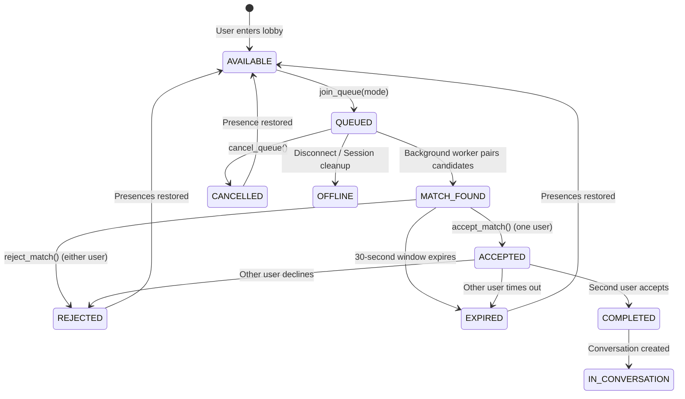

# Studable — Real-Time Matching Engine Architecture (Phase 5)

## 1. Overview & Objective

The **Real-Time Matching Engine** is the core social discovery layer of Studable. It connects verified, available users based on real-time availability, compatibility preferences, language synergy, and shared interests.

Key Principles:
- **Zero Polling**: All matching state transitions, proposal alerts, and mutual acceptances are pushed instantly via Redis Pub/Sub and WebSockets.
- **Fairness & Concurrency Safety**: FIFO ordering with waiting duration bonuses. Atomic Redis operations and distributed locking prevent double-matching across multi-worker deployments.
- **High Availability & Durability**: Ephemeral queue and reservation states reside in Redis with TTLs; persistent historical records, metrics, and conversation links are committed to PostgreSQL.
- **Privacy & Security**: Short-lived, single-use WebSocket tickets (`POST /api/v1/ws/ticket`) protect access tokens from exposure in query logs.

---

## 2. Matching Modes

### 2.1 Random Matching
- Connects eligible available users who have enabled `allow_random_discovery`.
- Preserves user safety rules: mutual block checks, suspension enforcement, and optional category/audience alignment.
- Prioritized strictly by wait duration (FIFO).

### 2.2 Interest-Based Matching
Deterministic, configurable compatibility scoring based on:
$$ \text{Score} = (\text{SharedInterests} \times 3.0) + (\text{CommonLanguages} \times 2.0) + (\text{AudienceMatch} \times 1.5) + \text{CategoryBonus} + \text{WaitBonus} $$
- **Shared Interests**: 3 points per exact interest tag match.
- **Language Compatibility**: 2 points for common languages.
- **Audience Match**: 1.5–3 points for aligned target audiences ("Students", "Working Professionals", "Mentors", "Anyone").
- **Wait Duration Bonus**: +1 point per 10 seconds waiting (capped at 20 points) to guarantee prompt pairings even during off-peak hours.
- Scaled to a normalized range of 0–100%.

---

## 3. Redis Queue Schema & Distributed Locking

| Key Pattern | Data Structure | Purpose | TTL / Expiry |
| :--- | :--- | :--- | :--- |
| `matching:queue:random` | Sorted Set (`ZSET`) | FIFO queue of user IDs ordered by timestamp | Managed explicitly / cleaned on cancel |
| `matching:queue:interest` | Sorted Set (`ZSET`) | Interest matching queue ordered by timestamp | Managed explicitly / cleaned on cancel |
| `matching:user:{uid}:request` | Hash (`HMSET`) | Active queue request metadata | 600s (`QUEUE_TTL_SECONDS`) |
| `matching:reserved:{uid}` | String (`SET`) | Distributed mutex reserving user during proposal | 45s (`RESERVATION_TTL_SECONDS`) |
| `matching:match:{mid}` | Hash (`HMSET`) | Pending match proposal details & peer snapshot | 45s (`RESERVATION_TTL_SECONDS`) |
| `matching:match:{mid}:accepted`| Set (`SADD`) | Set of user IDs who accepted the proposal | 60s |
| `matching:worker:lock` | String (`SET NX`) | Distributed lock for queue pairing cycles | 4s |
| `ws:ticket:{ticket}` | String (`SET`) | Single-use short-lived WebSocket auth ticket | 30s |
| `channel:user:{uid}` | Pub/Sub Channel | Per-user event bus streamed across workers | Ephemeral |

---

## 4. Matching State Machine & Lifecycle

---

## 5. WebSocket & Real-Time Event Protocol

Connecting:
`wss://api.studable.app/api/v1/ws/matching?ticket=<opaque_ticket>`

Events Emitted by Server:
- `matching.status`: Snapshot of initial queue/proposal state on connect.
- `matching.queued`: Confirmation of entering the queue.
- `matching.found`: Proposal payload including peer summary, compatibility score, and countdown deadline.
- `matching.accepted`: Confirmation that the current user accepted.
- `matching.peer_accepted`: Notification that the peer accepted (mutual wait).
- `matching.rejected`: Notification that the proposal was declined.
- `matching.expired`: Notification that the 30-second acceptance window lapsed.
- `matching.completed`: Mutual acceptance confirmed; includes created `conversation_id`.
- `matching.cancelled`: Queue withdrawal confirmed.

---

## 6. Security & Infrastructure Mitigations

1. **Ticket-Based WS Handshake**: WebSockets accept short-lived opaque tickets generated by `POST /api/v1/ws/ticket` with Bearer auth, eliminating JWT exposure in query logs.
2. **Session Lease Expiration**: User session sets are backed by per-session lease keys (`presence:session:{session_id}:lease`). Crashed or severed clients are automatically reaped by `cleanup_stale_sessions`.
3. **Multi-Worker Fan-Out**: Real-time events publish to Redis Pub/Sub channels (`channel:user:{user_id}`). All uvicorn workers route notifications to local client WebSockets.
4. **Idempotency & Mutual Exclusion**: Atomic queue pop and reservation locks prevent two matching cycles or workers from forming competing matches for the same user.
